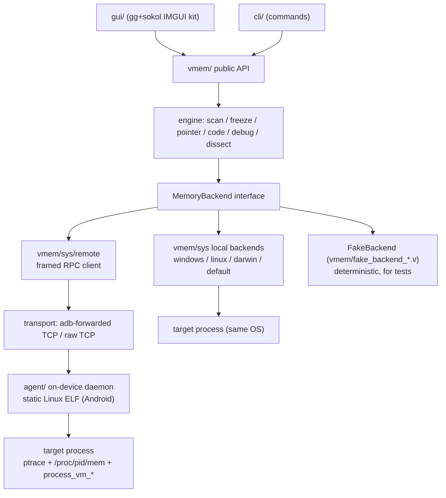

# Vmem — architecture

Companion documents: `AGENTS.md` (normative rules), `SKILL.md` (V + domain
context), `docs/PLAN.md` (phases), `docs/PLATFORM-API.md` (OS capabilities),
`docs/GUI.md` (front end).

## 1. Layering



Hard rules (enforced in review, see AGENTS.md §2):
- OS API calls only in `vmem/sys/` and `agent/`.
- Transport/protocol code only in `vmem/sys/remote/` and `agent/`.
- `gui/`, `cli/` only import `vmem`.
- The engine sees ALL targets through `MemoryBackend`; scan matcher semantics
  are shared pure functions compiled into both host and agent (D7).

## 2. Module tree

```
Vmem/
├── v.mod                     # manifest
├── AGENTS.md  SKILL.md  README.md  CHANGELOG.md
├── docs/                     PLAN.md ARCHITECTURE.md PLATFORM-API.md
│                             FEATURE-PARITY.md GUI.md
├── vmem/                     # import vmem  (the product)
│   ├── vmem.v                # module doc + version const, no logic
│   ├── types.v               # ValueType CompareOp RegionClass Region Module
│   │                         # ResultEntry ScanSessionPointerChain ... (decls only)
│   ├── errors.v              # error taxonomy (types + constructors only)
│   ├── open_process.v  close_process.v  enumerate_processes.v
│   ├── read_bytes.v  read_u8.v  read_u16.v  read_u32.v  read_u64.v
│   │   read_f32.v  read_f64.v  read_string_utf16le.v ...
│   ├── write_bytes.v  write_u32.v ...          # one fn per file
│   ├── enumerate_regions.v  enumerate_modules.v  dump_memory.v
│   ├── scan_first.v  scan_next.v  scan_refine.v  scan_plan.v
│   ├── freeze_add.v  freeze_remove.v  freeze_tick.v
│   ├── pointer_scan.v  pointer_rescan.v  pointer_resolve.v
│   ├── code_alloc.v  code_patch.v  code_hook.v  code_inject.v
│   ├── debug_break.v  debug_step.v  debug_regs.v
│   ├── _match_eval.v  _pattern_parse.v  _value_codec.v  _region_filter.v
│   └── sys/                  # backend seam — the only OS-touching layer
│       ├── backend.v         # MemoryBackend interface + capability flags
│       ├── decl_windows.c.v  decl_linux.c.v  decl_darwin.c.v
│       │                     # ^ grouped C prototypes/#include/#flag ONLY
│       ├── open_process_windows.c.v  open_process_linux.c.v
│       │   open_process_default.c.v ...        # one fn per file per OS
│       ├── backend_windows.c.v  backend_linux.c.v  # bind fn tables / select
│       └── remote/           # frida-style device transport client
│           ├── protocol/     opcodes.v frame.v handshake.v
│           │                 scan_plan_msg.v result_msg.v ...
│           ├── connect.v  attach.v  read_bytes.v  scan_execute.v ...
│           └── transport_tcp.v  transport_adb.v
├── agent/                    # on-device daemon (Android, frida-server role)
│   ├── main.v  server.v  session.v
│   └── handlers/             attach.v read_bytes.v write_bytes.v
│                             regions.v modules.v scan_chunk.v ...
├── cli/                      main.v cmd_scan.v cmd_maps.v cmd_freeze.v ...
├── gui/                      main.v app.v
│   ├── uikit/                panel.v table_virtual.v sparkline.v donut.v
│   │                         palette.v chip.v input.v theme.v
│   └── panels/               scan_panel.v results_panel.v inspector_panel.v
│                             timeline_bar.v pointer_panel.v
├── tests/                    victim/main.v  victim_mutate.v
│                             integration_scan_test.v golden/ ...
└── examples/                 find_and_freeze.v  aob_hook.v  device_scan.v
```

## 3. Backend contract (spec)

The engine addresses every target through this seam. Signatures are normative;
exact V spelling lands in P0.

```v
interface MemoryBackend {
	attach(pid int) !          // or connect(addr)/open by name — impl-defined
	detach() !
	read_bytes(addr u64, mut buf []u8) !int    // returns bytes actually read
	write_bytes(addr u64, buf []u8) !int
	enumerate_regions() ![]Region
	enumerate_modules() ![]Module
	capabilities() Capabilities  // scan_offload, regs, alloc, inject, freeze...
	scan_execute(plan ScanPlan, mut sink ScanSink) !   // optional capability
}
```

- `scan_execute` lets the remote backend run the SAME `ScanPlan` agent-side
  (GameGuardian model: scan where the data is). Host-side fallback executes the
  plan via chunked `read_bytes`. Matcher semantics are byte-identical (D7).
- Local backends return `EUnsupported` for absent capabilities (e.g. inject on
  hardened macOS).

## 4. Threading & memory model

| Component | Model |
|---|---|
| Scan workers | N = `runtime.nr_cpus()` (clamped 1..16); chunk queue over region ranges; per-worker scratch buffers (no alloc in loop); atomics for match counters; results batched via `sync` channel to the session |
| Session state | `ScanSession` is `mut`, single-writer (the collector thread); readers get immutable snapshots (GUI reads snapshots only) |
| Freeze | one ticker thread per session; per-entry interval wheel; failed re-writes retried with backoff |
| Remote | one transport connection, multiplexed request ids; watchdog re-connect; scan results streamed in batches (bounded queue) |
| GUI | render thread never blocks on engine; all updates via snapshot channels |

## 5. Error taxonomy (`vmem/errors.v`)

| Type | Meaning | Carries |
|---|---|---|
| `EAccessDenied` | OS refused (privileges, SELinux, protected process) | os_code, pid |
| `EProcessGone` | target exited mid-operation | pid, op |
| `ENotAttached` | op before attach / after detach | — |
| `EShortIO` | partial read/write | addr, want, got |
| `EUnsupported` | capability absent on this backend | capability |
| `ETransport` | device link down / timeout | detail |
| `EProtocol` | wire version mismatch, malformed frame | opcode, detail |
| `EBadPattern` | pattern/scan-plan parse error | input, position |
| `ERange` | address outside regions / bad parameters | addr |

Every error preserves the raw OS error code where one exists. Public functions
never panic on these conditions (AGENTS.md §4).

## 6. File naming & split rules (authoritative copy of AGENTS.md §3)

1. **One function = one file**; file name = function name (snake_case).
   Tests beside the file (`read_u32_test.v`).
2. Platform variance via V suffixes on the same base name:
   `<fn>_windows.c.v`, `<fn>_linux.c.v`, `<fn>_darwin.c.v`, `<fn>_default.c.v`.
   Android-specific behavior inside via `$if android` / `$if termux` blocks.
3. Exception (grouped): `sys/decl_<os>.c.v` holds that OS's `fn C.*`
   prototypes and `#include`/`#flag` lines — declarations only.
4. Declarations-only files for shared vocabulary: `types.v`, `errors.v`.
5. Internal helpers: `_` prefix, one concern per file, <150 lines.
6. No file mixes layers or both parses input and performs I/O.

## 7. Decision log

| ID | Decision | Why | Tradeoff |
|---|---|---|---|
| D1 | Android = frida-style host↔agent over ADB/TCP; NOT a Termux CLI | requirement ("like frida, it scans memory"); cross-process reads on Android need on-device privilege (SELinux); host tooling stays cross-platform | extra component (agent) + protocol to maintain |
| D2 | Custom binary framed RPC (LE), versioned handshake | zero deps, bulk streaming for scans, deterministic tests; V has no stdlib msgpack | hand-rolled codec to maintain |
| D3 | One function per file (user requirement) | navigation, review, merge safety | many small files; grouped `decl_<os>.c.v` exception keeps C prototypes sane |
| D4 | GUI = custom `gg`/sokol IMGUI kit, not vlang/ui | unique layout requirement; stock widget look; maintenance control | more UI code to write/maintain |
| D5 | Little-endian decode/encode everywhere | all supported targets are LE; matches CE/GG | future BE target needs a named param + changelog |
| D6 | No kernel drivers / anti-cheat evasion / multiplayer cheats | legal + ethical scope | some protected games stay untouchable — by design |
| D7 | One ScanPlan + shared matcher semantics, host or agent execution | identical results regardless of where scan runs; GG-class scan speed on device | matcher code compiled into two artifacts |
